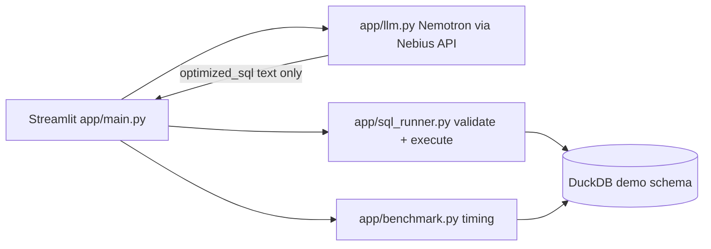

# SQL-Refinery

AI-assisted SQL optimization for the **NVIDIA × Nebius Global AI Hackathon**. SQL-Refinery asks a **Nemotron** model (via [Nebius Token Factory](https://docs.tokenfactory.nebius.com/api-reference/introduction)) for query rewrites, then **independently** checks correctness and benchmarks performance on a **controlled local DuckDB** demo database.

This repository is an **initial foundation**, not a finished hackathon submission. LLM suggestions are not trusted until DuckDB validation and comparison pass.

## Architecture



| Module | Responsibility |
|--------|----------------|
| `app/config.py` | Environment variables (API URL, model ID, DuckDB path) |
| `app/llm.py` | OpenAI SDK client → Nebius; returns JSON rewrite suggestion |
| `app/sql_runner.py` | SQLGlot validation, read-only execution, result comparison |
| `app/benchmark.py` | Warmup + timed runs; median comparison on local DuckDB |
| `app/main.py` | Streamlit UI wiring |
| `tests/` | Pytest coverage for execution, safety, comparison, benchmarks |

### Safety rules (current)

- Only **single-statement `SELECT`** (with optional `WITH`) is accepted from user or model text.
- Forbidden keywords (e.g. `DROP`, `INSERT`, `COPY`) are rejected before execution.
- Demo data is loaded from fixed DDL inside `sql_runner.py`, not from arbitrary files.

## Prerequisites

- Python 3.10+
- A Nebius Token Factory API key (for LLM suggestions only)

## Installation

```powershell
cd C:\Users\gur83\sql-refinery
python -m venv .venv
.\.venv\Scripts\Activate.ps1
pip install -r requirements.txt
copy .env.example .env
# Edit .env and set NEBIUS_API_KEY
```

## Run the app

```powershell
streamlit run app/main.py
```

## Run tests

```powershell
pytest
```

Tests do **not** call the Nebius API. Live LLM behavior must be verified manually after setting `NEBIUS_API_KEY`.

## Configuration

See `.env.example`. Defaults:

- **Base URL:** `https://api.tokenfactory.nebius.com/v1/`
- **Model:** `nvidia/Nemotron-3_5-Lightning` (change via `NEBIUS_MODEL` to any catalog ID you have access to)

## License

MIT — see [LICENSE](LICENSE).
