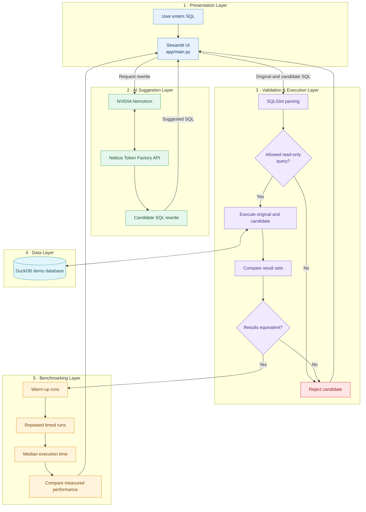

# SQL-Refinery

**AI-assisted SQL optimization with correctness verification and performance benchmarking.**

Built for the **NVIDIA × Nebius Global AI Hackathon**, SQL-Refinery uses NVIDIA Nemotron through Nebius Token Factory to propose SQL rewrites, then independently validates and benchmarks them against a controlled local DuckDB demo database.

> **Core principle:** AI proposes. The application validates. Measurements decide whether a rewrite is faster.

## ✨ What It Does

- **AI-assisted rewrites:** Ask Nemotron for an alternative SQL query.
- **Optimization rationale:** Review the model's reasoning and proposed SQL before comparison.
- **SQL safety checks:** Parse and validate candidate queries before execution.
- **Correctness verification:** Compare original and candidate query results before treating a rewrite as equivalent.
- **Performance benchmarking:** Use warm-up runs, repeated measurements, and median timings to compare execution time.
- **Local demo database:** Run against a predefined synthetic e-commerce dataset in DuckDB.
- **Performance reporting:** Display baseline and candidate timings, performance change, and speedup ratio.
- **Automated tests:** Test core validation and benchmarking behavior without spending API credits.

## 🏗️ Architecture

The application separates AI suggestions from SQL validation, execution, correctness checks, and performance measurement. The model does **not** get to declare its own output safe or correct.



### Request Lifecycle

1. The user submits a SQL query through the Streamlit interface.
2. Nemotron generates a proposed rewrite through Nebius Token Factory.
3. The application parses and validates the candidate against its supported read-only SQL rules.
4. The original and candidate queries execute against the controlled DuckDB demo database.
5. Their results are compared. A candidate that fails validation or equivalence checks must not be treated as a verified rewrite.
6. An accepted, equivalent candidate proceeds to performance benchmarking.
7. The application reports measured performance instead of assuming every rewrite is faster.

### Code Map

| File | Responsibility |
|---|---|
| `app/main.py` | Streamlit interface and application workflow |
| `app/llm.py` | Calls Nemotron through the Nebius-compatible API |
| `app/sql_runner.py` | SQL parsing, safety validation, query execution, and result comparison |
| `app/benchmark.py` | Warm-up runs, repeated timing, and benchmark summaries |
| `app/config.py` | Reads application configuration and environment variables |
| `tests/` | Automated tests for core behavior |

## 🧰 Tech Stack

- **Language:** Python 3.10+
- **UI:** Streamlit
- **AI Model:** NVIDIA Nemotron
- **Model API:** Nebius Token Factory
- **SQL Parsing:** SQLGlot
- **Local Query Engine:** DuckDB
- **API Client:** OpenAI Python SDK
- **Testing:** pytest

## 🛡️ Safety & Correctness

SQL-Refinery is a local demo application, not a production SQL security boundary.

- Supports a restricted single-statement, read-only SQL workflow, including supported `SELECT` and `WITH` queries.
- Rejects unsupported or destructive statement types before execution.
- Validates candidate SQL independently of the LLM.
- Uses a predefined demo schema and dataset rather than arbitrary external database connections.
- Compares query results before treating a rewrite as equivalent.
- Treats model output as untrusted input.

SQL parsing and application-level checks are defense-in-depth. They are not a substitute for database permissions, sandboxing, resource limits, or a production security review.

## 📊 Benchmarking Approach

SQL-Refinery measures performance instead of promising that every AI-generated rewrite is an optimization.

- **Warm-up executions:** Reduce the impact of first-run effects.
- **Repeated measurements:** Observe execution time across multiple runs.
- **Median timings:** Reduce sensitivity to unusually fast or slow runs.
- **Performance comparison:** Compare original and candidate query execution times.
- **Honest reporting:** A rewrite may produce equivalent results without being faster.

Results depend on the query, dataset, hardware, and runtime conditions. Measurements from the local demo database are illustrative and do not guarantee production performance improvements.

## 🧪 Development & Testing

Recent development focused on testing the application workflow, checking query correctness, and observing how AI-generated rewrites perform against the baseline query.

### Manual Test Scenarios

The following scenarios were exercised during development:

| Test scenario | Observed behavior |
|---|---|
| Empty result sets | Equivalent empty results were accepted |
| Different scalar values | Result mismatch was detected |
| Duplicate rows | Difference in row counts was detected |
| Invalid column reference | Execution failed with a database binder error; the UI's validation status needs further review |
| Filter removal | Different results were detected |
| `COUNT(*)` vs. `COUNT(DISTINCT ...)` | Different results were detected in the tested query |
| NULL-sensitive counting | Difference between `COUNT(*)` and `COUNT(column)` was detected |
| Multiple SQL statements | Multiple-statement candidate was rejected |
| Equivalent query benchmarking | Median timings and performance comparison were produced |
| AI rewrite workflow | Candidate generation, review, validation, comparison, and reporting were exercised |
| Slower candidate | The report correctly showed a candidate that was slower despite equivalent results |

These are manual development checks, not a claim that all SQL edge cases have been resolved.

### Benchmark Observations

During a test involving an aggregation query grouped by order status, the application reported equivalent results and the following timings:

| Metric | Observed result |
|---|---:|
| Baseline median | 11.36 ms |
| Candidate median | 11.98 ms |
| Reported performance change | -5.41% |
| Speedup ratio | 0.95× |
| Correctness report | Same multiset of rows; order differed |

The report identified the candidate as slower. This illustrates why SQL-Refinery measures performance rather than assuming that an AI-generated rewrite is automatically an improvement.

These measurements are specific to one run and the local demo environment. They do not establish a general performance improvement or regression.

### Known Issues & Improvements

- **Ordered-result comparison:** The application has reported results as equivalent when the row order differed. Queries containing `ORDER BY` may require order-sensitive comparison to preserve their output semantics.
- **Aggregation mismatch:** One test unexpectedly reported equivalent results for `COUNT(*)` and `COUNT(DISTINCT country)` grouped by country. This behavior needs investigation and regression testing.
- **Validation status:** An invalid column reference was rejected during execution, but the UI still displayed “Candidate SQL valid.” Validation and execution errors should be distinguished clearly in the interface.
- **Benchmark stability:** Small differences between runs require controlled repeated measurements before drawing strong conclusions.
- **Join equivalence:** Join changes should be tested against data that includes unmatched rows, since the demo dataset may not expose every semantic difference.

### Run Automated Tests

Run the test suite with:

```powershell
python -m pytest
```

The automated tests are designed to verify core behavior without making model API calls, helping conserve API credits.

## 🚀 Getting Started

### Requirements

- Python 3.10 or newer
- A Nebius Token Factory API key for AI rewrite requests

### 1. Clone the Repository

```powershell
git clone https://github.com/gurleen55555/sql-refinery.git
cd sql-refinery
```

If you already have the repository locally, navigate to its project folder instead.

### 2. Create and Activate a Virtual Environment

```powershell
python -m venv .venv
.\.venv\Scripts\Activate.ps1
```

If PowerShell blocks environment activation, you can run the environment's Python executable directly using `.venv\Scripts\python.exe`.

### 3. Install Dependencies

```powershell
python -m pip install -r requirements.txt
```

### 4. Configure the API

Copy the example environment file:

```powershell
Copy-Item .env.example .env
```

Open `.env` and set `NEBIUS_API_KEY` to your own API key. Never commit your real API key to GitHub.

Check `.env.example` for the supported configuration variables and defaults.

The default API base URL is:

```text
https://api.tokenfactory.nebius.com/v1/
```

The model ID is configurable through `NEBIUS_MODEL`. Use a model identifier supported by your Nebius Token Factory account.

### 5. Start the Application

```powershell
python -m streamlit run app/main.py
```

Streamlit will display a local URL in the terminal. Open that URL in your browser to use SQL-Refinery.

## 🧪 Development & Testing

We tested SQL-Refinery using a combination of manual test cases and the existing automated test suite. The goal was to evaluate SQL safety, query correctness, AI-powered rewriting, and performance benchmarking.

### Features Implemented and Tested

- **AI-Powered SQL Rewriting:** Integrated NVIDIA Nemotron through Nebius Token Factory to generate candidate SQL rewrites.
- **SQL Validation and Safety:** Tested invalid column references and multiple SQL statements, including a statement attempting to drop a table.
- **Synthetic Demo Database:** Used DuckDB with five related tables: `customers`, `orders`, `products`, `order_items`, and `payments`.
- **Query Result Comparison:** Tested differences in filters, duplicate rows, aggregate functions, and `NULL` handling.
- **Performance Benchmarking:** Compared original and candidate SQL queries using repeated execution timings and median runtimes.
- **Automated Testing:** Used `pytest` and manual application tests to check important query execution and validation scenarios.
- **End-to-End Workflow:** Tested the process of entering a query, generating an AI rewrite, validating both queries, comparing results, and reviewing benchmark results.

### Manual Test Scenarios

| Test Scenario | Observed Result |
|---|---|
| Query returning an empty result set | Both queries executed and produced equivalent results. |
| Different scalar values | Result mismatch detected; benchmarking was skipped. |
| Duplicate rows | Difference in row counts detected. |
| Invalid column reference | Execution failed as expected, but the validation status displayed by the UI needs correction. |
| Removing a filter condition | Different results detected. |
| `COUNT(*)` vs. `COUNT(DISTINCT ...)` | Different results detected in the tested query. |
| `COUNT(*)` vs. `COUNT(column)` with `NULL` values | Different results detected. |
| Multiple SQL statements | Candidate query rejected; benchmarking was skipped. |
| AI-generated SQL rewrite | Rewrite generated successfully and the workflow completed for the tested query. |
| Performance comparison | Runtime measurements and performance changes were displayed. |

### Benchmark Observation

During one end-to-end test, we evaluated a query that grouped orders by status and calculated order counts, total amounts, and average amounts.

| Metric | Observed Value |
|---|---:|
| Original query median runtime | 11.36 ms |
| Candidate query median runtime | 11.98 ms |
| Performance change | -5.41% |
| Speedup | 0.95× |

**Observation:** The candidate query was approximately 5.41% slower in this run. This demonstrates why SQL-Refinery measures actual execution performance instead of assuming that an AI-generated rewrite is always faster.

These measurements are specific to this test run and should not be treated as universal performance results.

### Known Limitations and Future Improvements

The following issues were identified during testing and require further investigation:

- **Order-sensitive result comparison:** The current comparison can treat queries returning the same rows in a different order as equivalent, even when `ORDER BY` makes the order meaningful.
- **Aggregation equivalence:** One deliberately different aggregation test unexpectedly reported equivalent results. The comparison logic and test setup need further investigation.
- **Validation status consistency:** An invalid column reference was labeled as valid by the UI even though query execution failed.
- **Benchmark stability:** A controlled test using exactly the same SQL for both baseline and candidate queries is still needed to assess timing variability.
- **Join equivalence:** Additional test data containing unmatched records is needed to thoroughly test differences between `INNER JOIN` and `LEFT JOIN`.

### Development Status

SQL-Refinery has a working prototype for AI-assisted SQL rewriting, SQL execution, result comparison, and performance benchmarking. Manual testing has verified several important correctness and safety scenarios, while also identifying areas that need improvement.

The project is under active development. The identified limitations will guide future improvements to result comparison, validation feedback, and benchmark reliability.

## 🔐 Environment & Secrets

- Store credentials in your local `.env` file.
- Keep `.env` out of version control.
- Use `.env.example` to document required configuration variables without including real secrets.
- Never expose your Nebius API key in source code, screenshots, logs, or public repositories.
- Rotate the key immediately if it is accidentally exposed.

## 🗺️ Project Status

SQL-Refinery is an evolving hackathon project demonstrating a careful workflow for AI-assisted SQL rewriting.

Its central idea is simple: **an AI-generated query is only a useful optimization candidate when it passes independent validation, produces equivalent results, and is evaluated using actual performance measurements.**

The core workflow has been exercised with synthetic data. Result-order semantics, aggregation edge cases, and clearer validation reporting remain areas for improvement.

## 📄 License

This project is licensed under the MIT License. See [`LICENSE`](LICENSE) for details.
